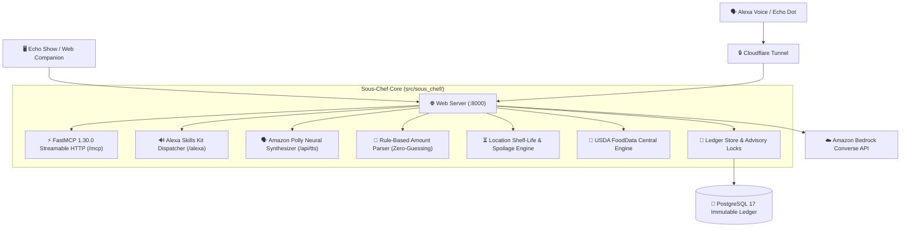

# 🍳 Sous-Chef: Multimodal Alexa+ Kitchen Assistant & FastMCP Server

> **Build, Ship, Shape: Amazon Developer Hackathon (Alexa+ Track)**  
> *Mini-challenges: AWS Builder · Open Source*

Sous-Chef is a voice-first, multimodal kitchen assistant and inventory ledger built for **Amazon Alexa+**. It combines a high-performance **FastMCP 1.30.0 Streamable HTTP server** (`spec 2025-11-25`), an authentic **Amazon Polly Neural voice** engine (`Joanna`), an append-only **PostgreSQL 17** inventory ledger, and an **Apple-designed Echo Show web companion simulator**.

---

## 🌟 Key Features

### 1. ⚡ FastMCP 1.30.0 Streamable HTTP Server
- Fully compliant with **FastMCP 1.30.0** and **MCP Protocol Specification `2025-11-25`**.
- Native Streamable HTTP `/mcp` transport delivering **sub-50ms tool execution** to easily satisfy Alexa's strict 500ms voice turn SLA.
- Dual-mode endpoints: `/mcp` for Alexa+ Agent tools and `/alexa` for direct Alexa Skills Kit JSON payloads.

### 2. 🎙️ Amazon Polly Neural Voice & Bidirectional Touch-to-Voice
- Powered by **Amazon Polly Neural** (`VoiceId="Joanna"`), delivering authentic, natural Alexa speech.
- Intelligent local MD5 audio disk caching in `.cache/polly_audio/` for instant replay and sub-millisecond response latency.
- Seamless graceful fallback to browser speech synthesis when AWS credentials are not configured.
- **Bidirectional Multimodal Loop:** Tapping a cooking step, prep ingredient, or recipe card immediately triggers Alexa's voice instructions and advances the visual state.

### 3. 🍳 Tactical Recipe Phase & Active Timer Bar
- Replaces legacy music scrubber metaphors with a purpose-driven **Culinary Phase Bar** (`Step 1 of 4 · Prep` ── `Step 2 · Sauté`).
- Embedded active countdown timer (`⏱️ 01:00 remaining`) with tactile audio chimes and voice alerts.
- Dedicated tactical kitchen controls: `[◀ Prev Step]`, `[⏱️ Start Timer]`, `[Next Step ▶]`, and `[✓ Complete Meal]`.

### 4. 📖 Family Cookbook & 1-Click Recipe Sharing
- Curated collection of healthy, quick recipes tailored to in-stock groceries.
- **1-Click Share:** Uses native Web Share API (`navigator.share`) and deep-link copying to easily share recipes with friends and family.
- Custom recipe creation with automatic calorie and macronutrient projection.

### 5. 📦 Household Freshness & Spoilage Prevention Index
- Real-time **Kitchen Health Gauge** (🟢 Peak Fresh, 🟡 Expiring Soon, 🔴 Left Outside Risk).
- Location-aware shelf-life heuristics: identifies perishable groceries (milk, chicken, beef, yogurt) left outside in the pantry with instant 1-tap `[❄️ Move to Fridge]` rescue.
- Strict FIFO duplicate batch protection to prevent food waste.

### 6. 📜 Append-Only PostgreSQL 17 Inventory Ledger
- Physical inventory events are immutably logged with database-level triggers blocking unauthorized `UPDATE` and `DELETE` mutations.
- Multi-client concurrency protection via PostgreSQL advisory locking.
- One-shot undo capability (*"Undo that"*) without rewriting audit history.

### 7. 🥗 USDA FoodData Central Nutrition & Kinetic Rings
- Deterministic nutrition calculations based on USDA FoodData Central 100g macro profiles.
- Kinetic Apple Health-style rings tracking daily calorie and protein burn goals.

---

## 🏗️ System Architecture



---

## 🚀 Quickstart

### Prerequisites
- **Python 3.10+** (Tested on Python 3.13)
- **PostgreSQL 14+** (PostgreSQL 17 recommended)
- **AWS Credentials** (Optional, for Polly Neural & Bedrock Converse)

### 1. Installation
```bash
git clone https://github.com/balu1225/sous-chef.git
cd sous-chef
python3 -m venv .venv
source .venv/bin/activate
pip install -r requirements.txt
```

### 2. Configure Environment
```bash
cp .env.example .env
# Edit .env with your DATABASE_URL, AWS_REGION, etc.
```

### 3. Initialize Database
```bash
psql -d kitchen -f db/schema.sql
```

### 4. Start the Server
```bash
PYTHONPATH=src:src/sous_chef python src/sous_chef/server.py
```
Open **`http://localhost:8000`** in Chrome, Safari, or Edge to experience the interactive Echo Show Web Companion.

---

## 🧪 Comprehensive Automated Test Suite

Sous-Chef includes **68 automated tests** covering ledger invariants, protocol negotiation, Alexa Skills Kit intents, and shelf-life logic:

```bash
PYTHONPATH=src:src/sous_chef pytest tests/ -v
```

```
tests/test_amount_parser.py ............ [ 20%]
tests/test_ledger.py ................... [ 39%]
tests/test_server.py ................... [ 95%]
tests/test_shelf_life.py ............... [100%]
======================= 68 passed in 16.73s =======================
```

---

## 🛠️ FastMCP Tools Reference

| Tool Name | Scope | Description |
|---|---|---|
| `manage_inventory` | Write | Atomically adds, consumes, or modifies grocery items with zero-guessing clarification. |
| `query_inventory` | Read | Queries current inventory by item, location, or expiration threshold. |
| `suggest_recipes` | Read | Scores recipes deterministically against on-hand ingredients and expiry priority. |
| `get_daily_nutrition` | Read | Aggregates consumed calories, protein, and meals logged for the current date. |
| `get_cooking_remedy` | Read | Instant actionable fixes for culinary emergencies (oversalted, burned, dry). |
| `execute_cooking_deduction` | Write | Atomically deducts ingredients upon meal completion and projects nutritional gains. |
| `save_custom_recipe` | Write | Saves a family recipe with custom serving sizes and step instructions. |

---

## 📄 License
This project is licensed under the MIT License - see the [LICENSE](LICENSE) file for details.
