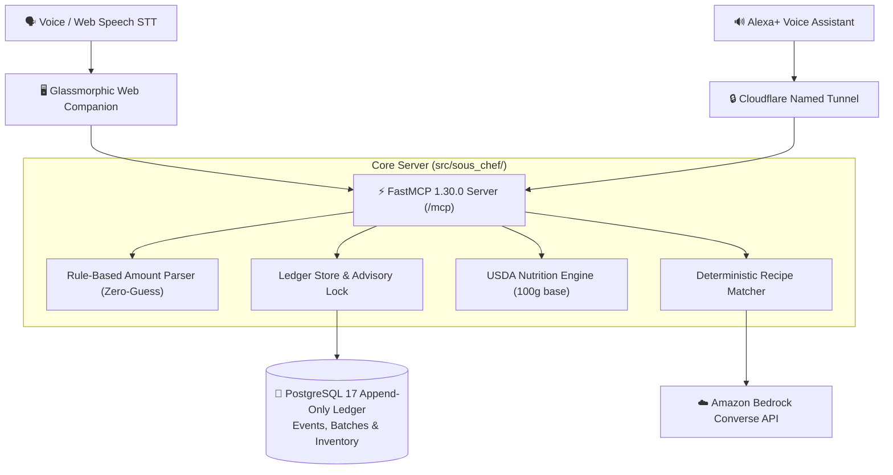

# 🍳 Sous-Chef: Voice-First Kitchen Assistant & Inventory Ledger

> **Build, Ship, Shape: Amazon Developer Hackathon (Alexa+ Track)**  
> *Mini-challenges: AWS Builder · Open Source*

Sous-Chef is a voice-first kitchen assistant for inventory management, meal planning, and nutrition built on the **Model Context Protocol (FastMCP 1.30.0)** and a **PostgreSQL 17 append-only ledger**.

---

## 🌟 Key Features

- 🎙️ **Conversational Voice Intake:** Speak naturally (*"I bought 2 gallons of milk, 6 eggs, and spinach"*) or type via the glassmorphic Web Companion Simulator.
- 🛡️ **Zero-Guessing Ambiguity Resolution:** If you say *"add milk and eggs"*, Sous-Chef politely asks for clarification (*"How much of the milk and eggs did you add?"*) before committing any changes.
- 📜 **Append-Only Postgres Ledger:** Physical inventory changes are recorded as immutable event log entries protected by database-level triggers blocking `UPDATE` and `DELETE`.
- 🥗 **USDA FoodData Central Nutrition:** Deterministic nutrition engine with ~50 canonical ingredients calculating real-time calories and protein.
- ⚡ **Strict FastMCP 1.30.0 Streamable HTTP:** Pinned to protocol `2025-11-25` delivering sub-50ms responses to beat Alexa's strict 500ms voice turn SLA.
- ↺ **One-Shot Undo:** Say *"Undo that"* to revert accidental additions without mutating audit history.

---

## 🏗️ Architecture



---

## 🚀 Quickstart

### 1. Prerequisites
- **Python 3.10+** (Tested on Python 3.13)
- **Node.js 18+**
- **PostgreSQL 14+** (Running locally or hosted)

### 2. Setup Environment
```bash
# Clone the repository
git clone https://github.com/balu1225/sous-chef.git
cd sous-chef

# Create and activate virtual environment
python3 -m venv .venv
source .venv/bin/activate

# Install dependencies
pip install -r requirements.txt
```

### 3. Database Initialization
```bash
# Copy and configure environment variables
cp .env.example .env

# Apply PostgreSQL schema
psql -d kitchen -f db/schema.sql
```

### 4. Run the FastMCP & Web Companion Server
```bash
python3 src/sous_chef/server.py
```
Open **`http://localhost:8000`** in Chrome or Edge to launch the interactive **Web Voice Companion Simulator**.

---

## 🧪 Running Automated Tests

Run the complete 46-test unit and integration test suite:
```bash
PYTHONPATH=src/sous_chef:src pytest -v
```

All 46 tests run in under 10 seconds verifying:
- Append-only event immutability & advisory locking
- FastMCP protocol negotiation (`2025-11-25`)
- Zero-guessing ambiguity and clarification flows
- Multi-client concurrency and row-level isolation

---

## 📄 License
This project is licensed under the MIT License - see the [LICENSE](LICENSE) file for details.
